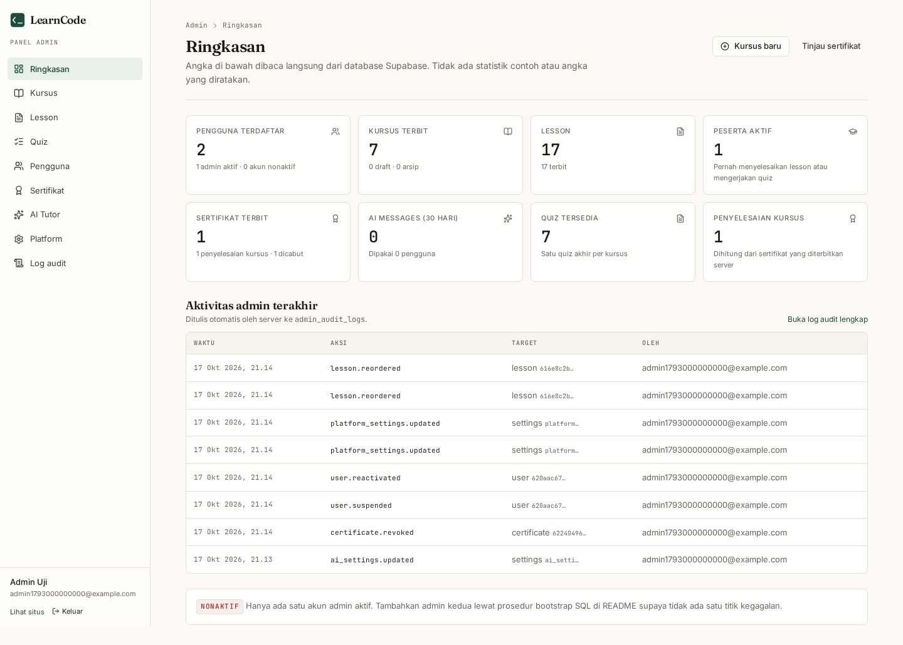

# LearnCode

**Learn by doing. Understand with AI.**

LearnCode is a working coding-education platform for HTML, CSS, and JavaScript.
It combines written lessons, a browser playground, a server-graded quiz, an AI
tutor powered exclusively by Groq, and certificates that are issued only after
the database confirms every requirement.

Everything described below is implemented in this repository. Where a feature
depends on external configuration (Supabase project, Groq key, SMTP), the
README says so explicitly instead of pretending it is already set up.

---

## 1. What is included

| Area | Route | Notes |
| --- | --- | --- |
| Landing page | `/` | Editorial marketing page, no fabricated metrics, testimonials, or partners |
| Catalogue | `/courses` | Three courses sourced from the database, with a content fallback |
| Course detail | `/courses/[slug]` | Objectives, lesson list, certificate requirements, quiz entry |
| Auth | `/login`, `/register`, `/forgot-password`, `/reset-password` | Supabase Auth, server actions, `next` redirect preservation |
| Auth callbacks | `/auth/confirm`, `/auth/callback` | Email OTP links and PKCE code exchange |
| Dashboard | `/dashboard` | Real progress, next-step recommendation, activity feed, empty state |
| Learning workspace | `/learn/[lessonSlug]` | Lesson sidebar/drawer, Shiki-highlighted examples, embedded exercise |
| Course quiz | `/courses/[slug]/quiz` | Server-side grading; answer keys never reach the browser |
| Playground | `/playground` | Monaco editor, three files, sandboxed iframe preview, console bridge |
| AI Tutor | `/ai-tutor` | Groq streaming, Indonesian/English, quota, history |
| Certificates | `/dashboard/certificates`, `/certificates/[certificateNumber]` | Server-issued only, PDF download |
| Public verification | `/verify/[verificationCode]` | No login required, no enumerable output |
| Settings | `/settings` | Profile, AI language, password change |
| Admin sign-in | `/admin` | Admin-only Supabase Auth sign-in; students get an access-denied page |
| Admin panel | `/admin/dashboard`, `/admin/courses`, `/admin/lessons`, `/admin/quizzes`, `/admin/users`, `/admin/certificates`, `/admin/ai-settings`, `/admin/settings`, `/admin/audit-logs` | Server-verified role, real database figures, audited mutations |

Database tables: `profiles`, `courses`, `lessons`, `lesson_progress`,
`quiz_attempts`, `quizzes`, `quiz_questions`, `ai_conversations`, `ai_messages`,
`ai_usage`, `certificates`, `platform_settings`, `ai_settings`,
`admin_audit_logs` — all with Row Level Security enabled.

---

## 2. Stack

- **Next.js 16.4.2** (App Router, React 19, `proxy.ts` instead of `middleware.ts`)
- **TypeScript** in strict mode
- **Tailwind CSS v4** with a small set of hand-written UI primitives (shadcn-style, no component library lock-in)
- **Supabase** Postgres + Auth (`@supabase/ssr`)
- **Groq** chat completions (`openai/gpt-oss-120b` by default) — the only AI provider
- **Monaco Editor** for the playground and lesson exercises
- **Zod** for every request body and form payload
- **pdf-lib + qrcode** for certificate PDFs
- **Vitest** for unit tests, **Playwright** for end-to-end tests

---

## 3. Local setup

```bash
git clone <your-repo-url> learncode
cd learncode
npm install
cp .env.example .env.local
```

Node 22 is required (`>=20.9` is declared, 22 LTS is what is tested).

```bash
npm run dev      # http://localhost:3000
npm run build    # production build
npm start        # serve the production build
```

`npm run dev` and `npm run build` both run `npm run prepare:assets`, which copies
`node_modules/monaco-editor/min/vs` into `public/monaco/vs`. That directory is
generated and git-ignored; the editor loads its workers from `/monaco/vs`, never
from a CDN.

### Environment variables

Copy `.env.example` to `.env.local` and fill in:

| Variable | Required | Purpose |
| --- | --- | --- |
| `NEXT_PUBLIC_APP_URL` | yes | Canonical origin. Used for auth redirects and QR verification URLs. No trailing slash. |
| `NEXT_PUBLIC_SUPABASE_URL` | yes | Supabase project URL |
| `NEXT_PUBLIC_SUPABASE_ANON_KEY` | yes | Public anon key (safe for the browser, protected by RLS) |
| `SUPABASE_SERVICE_ROLE_KEY` | yes | **Server only.** Quiz answer keys, certificate issuance, AI quota, public verification |
| `GROQ_API_KEY` | for AI | Server only. Without it the AI Tutor shows an explicit "not configured" notice |
| `GROQ_MODEL` | no | Defaults to `openai/gpt-oss-120b` |
| `AI_MAX_OUTPUT_TOKENS` | no | Defaults to `1200` |
| `AI_REQUEST_TIMEOUT_MS` | no | Defaults to `45000` |

The public catalogue, course pages, and `/verify/[code]` render with only the
public variables. Progress, quizzes, certificates, playground persistence, and
the AI Tutor need the full set.

> **Never** prefix the service role key with `NEXT_PUBLIC_`. It is imported only
> inside `src/lib/supabase/admin.ts`, which is marked `server-only`.

---

## 4. Database

### Applying the schema to a Supabase project

Option A — SQL editor, in filename order:

1. `supabase/migrations/20260101000000_learncode_schema.sql`
2. `supabase/migrations/20260102000000_admin_panel.sql`
3. `supabase/migrations/20260102000100_admin_ordering.sql`
4. `supabase/migrations/20260102000200_admin_read_models.sql`
5. `supabase/bootstrap_admin.sql` (creates the `bootstrap_admin()` helper)
6. `supabase/seed.sql` (generated from `src/content`)

Option B — Supabase CLI (a linked project):

```bash
supabase db push          # or: supabase migration up
psql "$DATABASE_URL" -f supabase/seed.sql
```

The migration is idempotent (`create table if not exists`, `drop policy if
exists` before `create policy`), so re-running it is safe.

`seed.sql` only inserts rows. It starts with a guard that stops with a readable
message (`Skema LearnCode belum ada di database ini…`) if the migrations have not
been applied yet, instead of a bare `relation "public.courses" does not exist`
(`42P01`) error.

### Regenerating the seed

Course content lives in TypeScript (`src/content/*.ts`). The seed is generated,
never hand-edited:

```bash
npm run seed:generate     # writes supabase/seed.sql
```

IDs are stable UUIDv5 values derived from slugs, so re-seeding updates the same
rows instead of creating duplicates.

### Verifying the schema and RLS locally

`supabase/tests/local_bootstrap.sql` recreates just enough of the Supabase
environment (roles, `auth` schema, `auth.uid()`) to exercise the migration
against a plain Postgres instance:

```bash
sudo -u postgres createdb learncode_verify
sudo -u postgres psql -d learncode_verify -f supabase/tests/local_bootstrap.sql
for f in supabase/migrations/20260101000000_learncode_schema.sql \
         supabase/migrations/20260102000000_admin_panel.sql \
         supabase/migrations/20260102000100_admin_ordering.sql \
         supabase/migrations/20260102000200_admin_read_models.sql \
         supabase/bootstrap_admin.sql \
         supabase/seed.sql \
         supabase/tests/rls_test.sql; do
  sudo -u postgres psql -q -d learncode_verify -v ON_ERROR_STOP=1 -f "$f" || break
done
# → ALL DATABASE ASSERTIONS PASSED
```

Use a **fresh** database for the assertions: `rls_test.sql` promotes an account
through `bootstrap_admin()`, so a database that already holds older profiles can
report stale fixture failures.

`rls_test.sql` asserts, among other things, that a learner cannot read another
learner's progress, quiz attempts, AI conversations, or certificates, and that
`anon` cannot read any user table.

These bootstrap scripts are for **local verification only** — never run them on
a Supabase project, which already provides the `auth` schema.

### Auth redirect URLs and SMTP

Supabase requires the URLs used in auth emails to be allow-listed:

**Authentication → URL Configuration**

- Site URL: `https://your-domain.example` (or `http://localhost:3000` locally)
- Redirect URLs:
  - `http://localhost:3000/auth/callback`
  - `https://your-domain.example/auth/callback`
  - `http://localhost:3000/auth/confirm`
  - `https://your-domain.example/auth/confirm`

`/auth/callback` handles the PKCE `code` (email confirmation and password
recovery) and `/auth/confirm` handles `token_hash` links. Both then redirect to
a `next` path validated by `safeRedirectPath`, defaulting to `/dashboard`.

**Email delivery.** Supabase's built-in SMTP is rate-limited and intended for
testing only; project owners can send a handful of emails per hour and delivery
often lands in spam. For real users configure **Authentication → Emails → SMTP
Settings** with your own provider (Resend, Postmark, SES, Mailgun, …) and set
the sender name/address. Until then, registration still works — the UI tells the
user a verification link was sent, and you can confirm accounts manually from
the Supabase dashboard. If email confirmation is turned off in Supabase, the
app signs the user in immediately after registration.

---

## 5. Admin panel

The admin panel is part of the same Next.js app, with its own layout and a
different sign-in page. Every page, server action and API route performs its own
session + role check against `profiles.role`; hiding buttons is never the
security boundary.

### Granting the first admin (trusted procedure)

Admin is **never** granted at signup and there is no public endpoint that
accepts an email and promotes it.

1. Create the account in the normal way (`/register`) or from the Supabase
   dashboard → Authentication → Users. Confirm the email address.
2. Verify the person behind the account out-of-band (the same way you would
   for any privileged access).
3. In the Supabase SQL editor (as the project owner), run:

   ```sql
   select public.bootstrap_admin('owner@example.com');
   ```

   The helper is `security definer`, executable only by the project owner /
   `service_role`, refuses an email that has no auth account, sets
   `profiles.role = 'admin'`, and clears any suspension. Re-running it is safe.
   Equivalent manual statement:

   ```sql
   update public.profiles set role = 'admin'
   where id = (select id from auth.users where email = 'owner@example.com');
   ```

4. Log in at `/admin`. A session that is not an admin is redirected to
   `/admin/dashboard` **without** access and sees an access-denied explanation;
   admin APIs answer `403`/`401`, never data.

Suspending an admin (`/admin/users/[id]`) removes admin privileges immediately:
`is_admin()` and the server helpers both require `suspended_at is null`.



### Screens and behaviour

| Screen | What it does |
| --- | --- |
| `/admin/dashboard` | Real counts from `admin_dashboard_stats()`: users, courses, lessons, participants, certificates, AI messages, recent audit entries, empty states |
| `/admin/courses` | Search, status filter, pagination, ordering, publish/archive, guarded delete |
| `/admin/courses/[id]` | Course fields, objectives, passing score, completion rules, lesson list with reorder/status, quiz link |
| `/admin/lessons` + editor | Markdown editor, code example, exercise, objectives, required flag, preview, publish validation |
| `/admin/quizzes` + editor | Quiz settings, weighted questions, options, explanations, ordering, attempt history |
| `/admin/users` | Search by name/email, progress, attempts, certificates, suspension |
| `/admin/certificates` | Search by number/recipient/course, verification status, eligibility review, admin PDF, reasoned revocation |
| `/admin/ai-settings` | Enable/disable AI, daily limit, input/output limits, per-feature toggles, Groq model, learning instructions |
| `/admin/settings` | Platform identity, contact, certificate defaults, maintenance mode |
| `/admin/audit-logs` | Server-written trail with filters and metadata |

### Security notes

- Reads use the request-scoped Supabase client (RLS enforced: admins can read
  all profiles, courses, lessons, quizzes and certificates; everyone else sees
  published content and their own rows). Mutations run through the service-role
  client **after** `requireAdminAction()` verified the session and role, and
  after rate limiting.
- The service-role key is server-only (`SUPABASE_SERVICE_ROLE_KEY`, no
  `NEXT_PUBLIC_` prefix). It is never sent to the browser.
- Zod validates every form payload; unknown keys are rejected. Database
  constraints (statuses, certificate-number format, audit-action format) are the
  second line of defence.
- `admin_audit_logs` is append-only: triggers reject `update` and `delete`, RLS
  exposes rows to admins only, and metadata is sanitised to drop
  password/token/secret-like keys.
- Certificate revocation is a separate confirmed action that requires a reason,
  stores actor + timestamp, keeps the row, and immediately changes
  `/verify/[code]` to “tidak berlaku”. Nothing deletes certificates.
- Changing quiz weights or passing scores never rewrites stored attempts
  (`score`, `passed`, `passing_score`, `scoring_snapshot`) and never revokes
  issued certificates. New eligibility checks use the course's current passing
  score; already-issued certificates stay valid until explicitly revoked.
- AI keys stay in environment variables. `/admin/ai-settings` stores only
  non-secret values (enabled flag, limits, model from the allow-list,
  instructions); the UI never echoes a key.

### Maintenance mode

`platform_settings.maintenance_mode` (toggle in `/admin/settings`) shows a
maintenance notice to learners in the app area; admins keep access. Marketing
pages and public certificate verification stay available.

---

## 6. How the main features work

### Progress and completion

- Opening a lesson never marks it complete. The lesson page only reads state.
- `POST /api/lessons/[id]/complete` verifies the session, resolves the lesson
  and course from the database (never from the body), and performs an idempotent
  `upsert` on `lesson_progress` with `onConflict: "user_id,lesson_id"`.
- The response returns fresh progress percentages plus the certificate
  eligibility snapshot, so the UI never has to guess.

### Quiz grading

- `GET` data for the quiz page comes from `getSanitizedQuizForCourse`, which
  strips `correct_option_id` and `explanation`.
- `POST /api/quizzes/[id]/submit` loads the answer key with the service role,
  grades on the server, stores `quiz_attempts` (score, passed, counts), and only
  then returns per-question feedback and explanations.
- Any score sent by the browser is ignored; the request schema is `.strict()`,
  so extra keys cause a 422.

### Certificates

Issued only by `ensureCourseCertificate` on the server when all of the
following hold:

1. every lesson in the course has a `lesson_progress` row for this user,
2. at least one quiz attempt exists,
3. the best score is ≥ the course `passing_score` (80 by default).

`(user_id, course_id)` is unique, so repeated calls return the same certificate.
Certificate numbers (`LC-YYYY-XXXXXXXX`) and verification codes (24-char
base64url) are generated with `crypto.randomBytes`. The public verification page
looks codes up server-side and renders an identical "not found" message for
invalid and unknown codes, so codes cannot be enumerated.

The PDF is rendered on demand from the database record by `pdf-lib`
(A4 landscape, embedded IBM Plex Serif / PT Sans, QR code pointing at
`${NEXT_PUBLIC_APP_URL}/verify/<code>`). It carries no secrets and no
accreditation claims.

### AI Tutor

- One pipeline, `runAiTutor`, serves `/api/ai/chat`, `/explain`, `/debug`, and
  `/hint`. Identity and language preference come from the verified session.
- Server-side quota: `consume_ai_message` increments `ai_usage` atomically and
  the request is rejected past `AI_DAILY_MESSAGE_LIMIT` (30 messages/day).
  An in-memory burst limiter is additional, not authoritative.
- Requests are validated with Zod (`max 4000` chars message, `max 8000` chars
  code, enum languages/actions). Output is capped by `AI_MAX_OUTPUT_TOKENS` and a
  45-second abort.
- Responses stream as Server-Sent Events: `start`, `delta`, `done`, `error`.
  Provider error bodies are never forwarded; they are mapped to stable codes
  (`ai_unconfigured`, `rate_limited`, `invalid_model`, `timeout`,
  `provider_error`, `network_error`).
- The system prompt forbids claiming code execution, leaking prompts or keys,
  and inventing platform features. Conversation history is persisted per user
  under RLS; the conversation list and delete endpoint are scoped by `user_id`.

### Playground scope (frontend only)

The playground compiles nothing and executes nothing on a server. HTML, CSS, and
JS are composed into a document string and loaded into an iframe with
`sandbox="allow-scripts"` (no `allow-same-origin`, no forms, no top navigation),
plus `referrerPolicy="no-referrer"`. `console.*` is bridged to the UI through
`postMessage` and validated against a fixed message shape. User JavaScript runs in
a `try/catch`, and closing `</script` sequences are escaped. "Save" stores the
project in this browser's `localStorage` — it is not synced to the account and
does not survive in another browser.

---

## 7. Tests

```bash
npm run lint
npm run typecheck
npm test            # Vitest unit tests
npm run test:e2e    # Playwright (starts the dev server unless PLAYWRIGHT_BASE_URL is set)
```

- Unit tests cover grading and completion rules, certificate identifiers, the PDF
  builder, markdown rendering, playground document construction and console
  validation, AI request validation, prompt construction, and content integrity
  (no placeholder copy, every lesson has objectives/exercise/quiz answer).
- Playwright (32 specs) covers the public catalogue, 404 handling, public
  verification, auth screens, and that every private route and API rejects
  unauthenticated access — including every `/admin/*` page, the admin
  certificate PDF endpoint, and the admin sign-in page itself. The suite is
  intentionally credential-free: it does not create users, so it can run in CI
  without a Supabase project.
- The database suite (`supabase/tests/rls_test.sql`) additionally asserts that
  learners cannot read `ai_settings` or `admin_audit_logs`, that admins can, that
  suspension removes admin privileges, and that the audit trail rejects UPDATE
  and DELETE even for the table owner.

### Optional: local full-stack harness

`tests/support/supabase-shim.mjs` is a **test-only** stand-in for PostgREST and
GoTrue. It executes the real SQL against a migrated local Postgres, so RLS,
triggers, constraints, and the quota function are genuinely exercised when you
walk through the UI without a hosted Supabase project. It is never imported by
application code and is not needed for deployment or for `npm test` /
`npm run test:e2e`. Point `NEXT_PUBLIC_SUPABASE_URL` at it only in a local
`.env.local`:

```bash
node tests/support/supabase-shim.mjs     # http://127.0.0.1:54321
```

The shim connects as an ordinary login role and then switches into
`anon` / `authenticated` / `service_role`, so that role needs membership and
schema grants once per database (hosted Supabase already ships these):

```sql
grant usage on schema auth to learncode_test;
grant select, insert, update, delete on all tables in schema auth to learncode_test;
grant usage on schema public to learncode_test;
grant select, insert, update, delete on all tables in schema public to learncode_test;
grant anon, authenticated, service_role, supabase_auth_admin to learncode_test;
```

Without them you will see `permission denied to set role "service_role"` or
`permission denied for schema auth`.

Real projects always use Supabase itself.

---

## 8. Deployment (Vercel)

1. Push the repository to GitHub.
2. Import it in Vercel; the framework preset is detected automatically.
3. Add the environment variables from §3 (all except the two public ones must be
   server-side).
4. Deploy. `npm run build` runs the Monaco asset copy and the production build.
5. After the first deploy, set `NEXT_PUBLIC_APP_URL` to the production domain,
   add the `/auth/callback` and `/auth/confirm` URLs to Supabase, and redeploy so
   the QR links embed the right origin.
6. `maxDuration = 60` is set on the AI route; streaming needs a runtime that
   supports long-lived responses (Vercel's Node.js runtime does).

Checklist for production:

- [ ] `SUPABASE_SERVICE_ROLE_KEY` set only as a server env var
- [ ] RLS enabled on every table (the migration does this)
- [ ] SMTP configured in Supabase (otherwise verification emails are unreliable)
- [ ] `GROQ_MODEL` points at a model your Groq account can access
- [ ] `NEXT_PUBLIC_APP_URL` matches the deployed origin

---

## 9. Project structure

```
src/
  app/
    (marketing)/        public pages, course catalogue, /verify
    (auth)/             login, register, password reset
    (app)/              dashboard, learn, playground, ai-tutor, certificates, settings
    (admin)/admin/      dashboard, courses, lessons, quizzes, users, certificates, settings, audit logs
    (admin-auth)/admin/ admin sign-in page
    api/                AI, quizzes, lessons, courses, certificates, admin PDF
    auth/               /auth/callback, /auth/confirm route handlers
  components/
    ai/ learning/ playground/ quiz/ certificates/ settings/ marketing/ ui/
  content/              authored courses + generated seed source
  lib/
    ai/                 prompt, Groq client, streaming service
    certificate/        pdf-lib document builder + embedded fonts
    admin/              admin authorization, audit trail, typed read models
    actions/            server actions (auth, learning, admin courses/lessons/quizzes/governance)
    data/               server data access (catalogue, learning, quiz, certificates)
    services/           pure completion rules + certificate issuance
    supabase/           browser, server, admin clients
    validation/         Zod schemas
supabase/
  migrations/           schema, admin tables/RLS/triggers, ordering + read-model SQL functions
  bootstrap_admin.sql   trusted role bootstrap helper (owner/service_role only)
  seed.sql              generated from src/content
  tests/                local bootstrap + RLS assertions
tests/unit/             Vitest specs
e2e/                    Playwright specs
```

---

## 10. Honest limitations

- The playground is frontend-only. There is no backend runner, no test harness,
  and no persistence of playground files to the account.
- AI quota is per user per calendar day (UTC), defaulting to 30 messages and
  configurable by an admin (1–200) in `/admin/ai-settings`; there is no billing
  integration.
- Admin access is granted only through the SQL bootstrap in §5. There is no
  self-service admin invitation UI.
- Certificates verify completion inside LearnCode. They are not academic credit
  and are not issued by an external accreditation body.
- The AI Tutor needs a working Groq key. Without one, the UI explains that the
  feature is unconfigured rather than failing silently.
- Email verification depends on Supabase SMTP; see §4.
